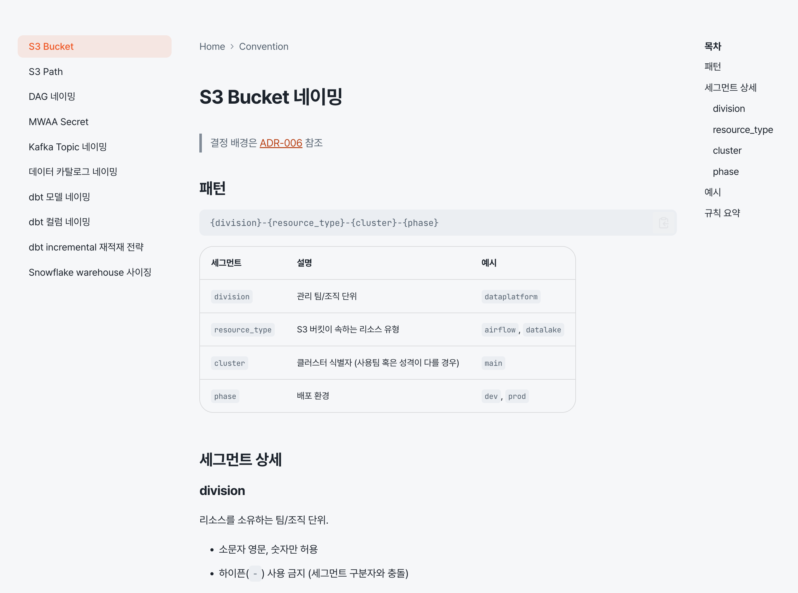
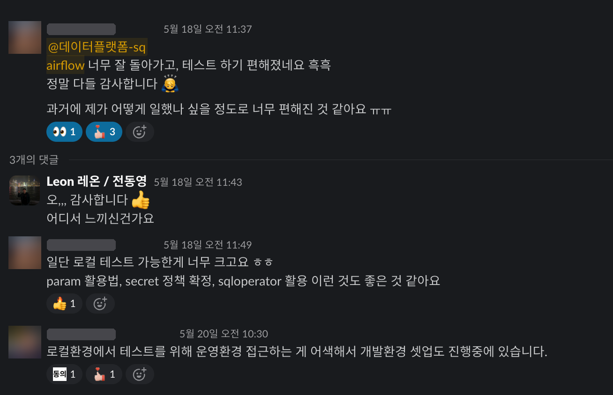
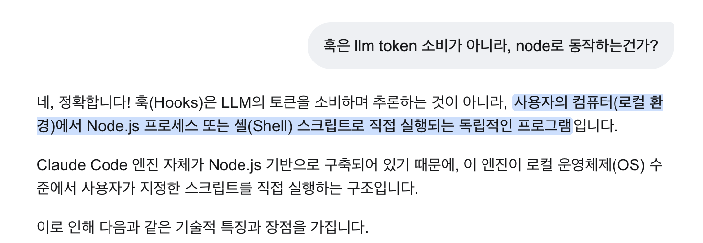
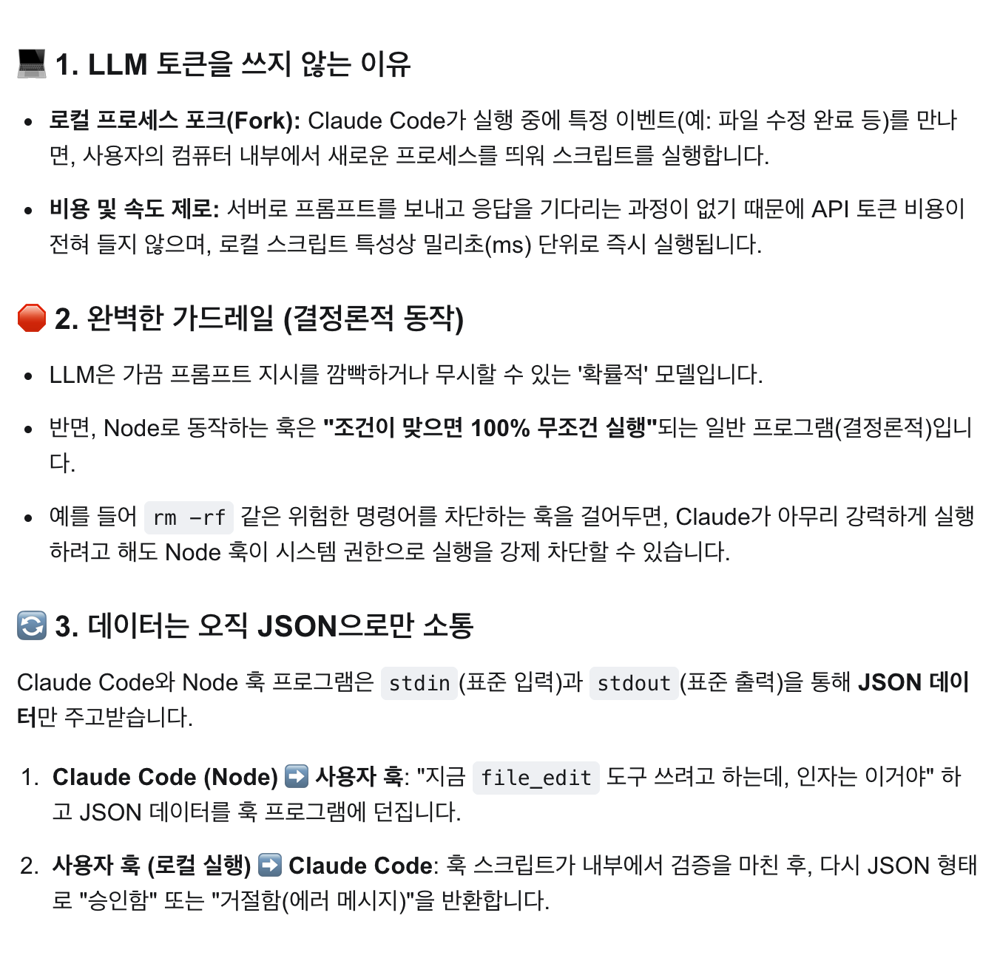
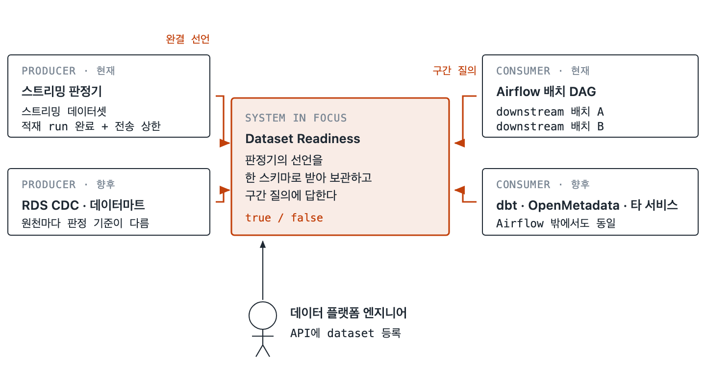
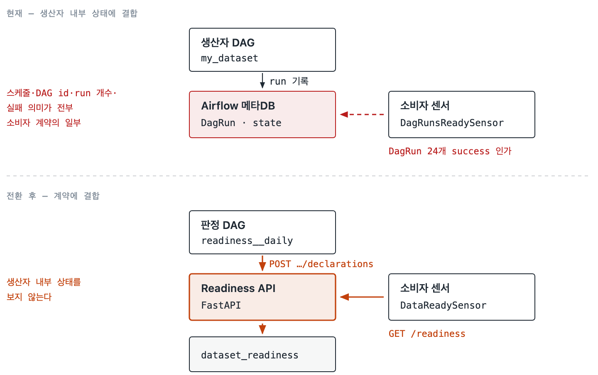
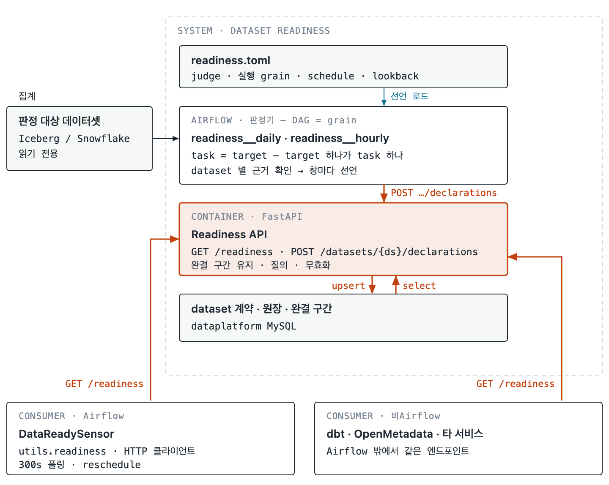
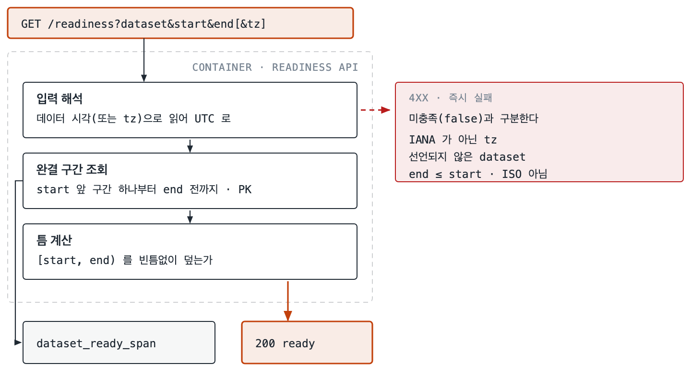
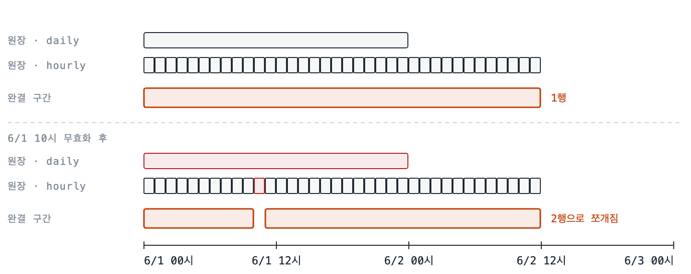

# Offline Seminar: Leon

## 목차

- [나는 요즘 어떻게 일하고 있나](#나는-요즘-어떻게-일하고-있나)
  - [Tool](#tool)
  - [강남언니 올때의 마인드](#강남언니-올때의-마인드)
- [가장 먼저 한 일: 개발환경구축](#가장-먼저-한-일-개발환경구축)
- [그 다음 한 일: 컨벤션 정의 (+ 문서 플랫폼 build w/ zensical)](#그-다음-한-일-컨벤션-정의--문서-플랫폼-build-w-zensical)
- [이후, 개발 환경 구축 II](#이후-개발-환경-구축-ii)
- [wiki 구축](#wiki-구축)
- [Test Data Generator](#test-data-generator)
- [Data Readiness API](#data-readiness-api)
- [마지막으로](#마지막으로)

---

## 나는 요즘 어떻게 일하고 있나

- 12월 나가서 이제 약 1년 가까이 되는중
- 커리어적으로 1년동안 꽤 열심히 사는 중
  - 멧돼지 책도 읽고, 오픈소스 활동도 하고, 연애 빼고 다 함;

### Tool

- cmux and herdr
- claude, codex (요즘은 거의 claude opus 5.5)
- git: 그냥 cli에서 pull, fetch 정보만하고 나머지는 전부 agent

### 강남언니 올때의 마인드

#### 1. 나는 잘 포장된 고속도로(토스, 빗썸)를 달리다가 갓길(강남언니)로 빠졌다. 2년 뒤 합류지점에서 더 앞서 있으리라

> 실제 리더 및 HR한테 1on1에서 말함

#### 2. 견고한 데이터 엔지니어링

- **Robust** (건장한) Data Engineering
- **Reliable** (신뢰할수있는) Data Engineering
- **Resilient** (회복탄력적인) Data Engineering
- **Intuitive** (직관적인) Data Engineering

#### 강남언니 환경 특성

- prod 환경까지 인터넷망에서 접근할 수 있음. (망분리가 안되어있는 환경)
- 따라서, 데이터 검증도 에이전트에게 시킬 수 있음
- agent only 개발이 되는 환경. 테스트/검증 기반의 환경 만들겠다 다짐 (agent로 속도를 챙기면서 테스트/검증을 통해서 안정성도 챙기겠다)

---

## 가장 먼저 한 일: 개발환경구축

- 패키지 인스톨 요청을 받아서 설치하려고 보니까, 사용버전 EOS(2.5.2).. 강제로 버전업까지
  - (+) 로컬 포함 테스트 환경 없고, 패키지 관리도 안되어있어서 dev 띄워서 테스트하는데 패키지 충돌 겁나 남. (3시간 넘게 삽질함)
  - 열받아서 주말에 local 환경 구성함
  - 그러면서 `smoke_test` DAG도 같이 만듦.
    - 강남언니 Airflow에서 사용하는 Operator 및 패턴 전부 찾아서 smoke test task로 만듦

> **What is smoke test?**
> 전자 회로 기판(PCB)을 조립한 뒤 전원을 처음 켰을 때 타는 연기가 나는지 안 나는지 확인하던 하드웨어 테스트에서 유래했습니다. 연기가 난다면 치명적인 결함이 있는 것이므로 즉시 테스트를 중단했습니다.

---

## 그 다음 한 일: 컨벤션 정의 (+ 문서 플랫폼 build w/ zensical)

- 컨벤션 정의 하나도 안되어있고, path 계층 하나도 안맞아서 뭐 에러나면 직관이 하나도 안생기는...
  - Prod MWAA Cluster Name: `MyAirflowEnvironment`, `data-model`
- 컨벤션이나 아키텍처 이런거 담을 곳 필요해서 이전 mkdocs 경험을 토대로 zensical을 만듬
  - zensical: mkdocs 만든 애들이 rust로 다시 구현한거



- 칭찬 타임



---

## 이후, 개발 환경 구축 II

- 기존 Dev 없던거 다 띄움.
  - Snowflake, EMR, \~\~ 암튼 빗썸처럼 set 맞춰서 다 띄움
    - _(빗썸에서 잘 배웠다..)_
  - 그래서 아래 흐름이 가능해짐

| 단계 | 환경 |
|---|---|
| 개발 | local |
| 개발 통합 테스트 | dev |
| 운영 | prod |

이후에는 대충 구실이 갖춰져서 열심히 이것저것 하는 중

---

## wiki 구축

- Sentinel이라는 어뷰징 유저 감지시스템 파이프라인이 있음
- 거의 AI Native 프로젝트
  - 멋모르고 진행해서 ai 신나게 쓰다가 나중에 뚜드려 맞은 프로젝트 (들어오자마자 멋모르고 진행한..)
    - 구조적으로 안티패턴 개많이 들어가게 됨.
      - Ex1) read / write pattern 달라서 매번 거의 풀스캔함
      - Ex2) 단일 테이블에 multi writer 구조여서 lock 졸라 생김
  - 이후에 정신차리고 수습함.
    - 테이블 재설계로…
    - **깨달은 점: 이해까지 위임한 AI Native 개발은 위험하다. → 개발자 안사라진다. → 야호**
- 이후에 내가 나간다면, 이것 때문에 나갈 것 같다 생각함. (ai native로 개발한게 오기때문에…)
  - 그래서 wiki를 만들었음
    - 이때 안드레 카파시가 위키라는 컨셉을 이야기함
    - 이거보고 뭐 이것저것 만들었는데, 문제는 최신화를 어떻게 잘 하지? 고민이 됨
    - 찾아보니 Hook이라는 개념이 존재.





<details>
<summary>hook 예시 (<code>./main/.claude/hooks/wiki-ingest-reminder.js</code>)</summary>

```javascript
#!/usr/bin/env node
// PostToolUse hook for Sentinel RiskFlow wiki ingest reminder.
// Reads Claude Code hook payload from stdin. When the edited file matches a
// sentinel_riskflow SQL path or the sentinel feature pipeline DAG, emits a
// system reminder asking Claude to invoke the sentinel-wiki-ingest skill.
// No external dependencies — pure Node stdlib.
const SENTINEL_SQL = /airflow\/dags\/sql\/sentinel_riskflow\/.+\.sql$/;
const SENTINEL_DAG = /airflow\/dags\/~~~feature_pipeline__daily\.py$/;

let buf = '';
process.stdin.setEncoding('utf8');
process.stdin.on('data', c => { buf += c; });
process.stdin.on('end', () => {
  let payload;
  try {
    payload = JSON.parse(buf);
  } catch {
    process.exit(0);
  }

  const filePath = payload && payload.tool_input && payload.tool_input.file_path;
  if (typeof filePath !== 'string' || filePath.length === 0) {
    process.exit(0);
  }

  const isSql = SENTINEL_SQL.test(filePath);
  const isDag = SENTINEL_DAG.test(filePath);
  if (!isSql && !isDag) {
    process.exit(0);
  }

  const subject = isSql ? 'SQL' : '~~feature pipeline DAG';
  const reminder =
    `[sentinel-wiki-ingest] ${subject} 변경 감지: ${filePath}\n` +
    `SQL이 SSOT(ADR-007)이고 .wiki/ 는 read-only mirror다. ` +
    `이번 변경에 대응해 wiki 페이지(features/, tags/, pipeline/, index.md, log.md)를 동기화해야 한다. ` +
    `sentinel-wiki-ingest skill의 절차(Step 1~7)를 따른다.`;

  process.stdout.write(JSON.stringify({
    continue: true,
    hookSpecificOutput: {
      hookEventName: 'PostToolUse',
      additionalContext: reminder,
    },
  }));
  process.exit(0);
});
```

</details>

---

## Test Data Generator

```
Client Log 수집기(producer) → Kafka (MSK) → Python App. (consumer, single node) → Redis → 이후에 ml-ops 추천용
```

- log가 몰리면 얼마나 견고하나
  - producer, consumer, kafka
- 테스터기 필요해서 운영데이터 분포 파악하라고 하고, 그거에 맞게 랜덤하게 테스트 데이터 만들어주는 테스트기 생성.
  - 초당 10만건이상 발행 (일평균 부하의 약 1000배정도였을듯)
  - producer는 scale-out하면서 잘 버팀
  - consumer도 문제없이 잘 버팀
- datadog 모니터링 대시보드 구성
  - 개멋짐…
- 느낀점:
  - 테스트기 만들어두니까 정말 좋더라
  - 여러모로 쓸만하더라
  - 데이터독 최고더라

---

## Data Readiness API

Airflow에서 보통 `ExternalTaskSensor`로 센싱하는데, 아래와 같은 불편함이 있음

1. 시간 맞춰줘야 함
2. 배치간격이 달라지면? downstream에서 대응해줘야 함 (강남언니는 downstream DAG를 각 스쿼드에서 관리하는 구조 - ML, Search, DAE 등)
3. 스트리밍 데이터를 배치에서 센싱하기 어려움
4. 장애발생 후, `catchup=False`되어있으면 다운스트림에서 센싱이 불편함. (해당 시간에 정확히 맞는 dag-task를 발행해줘야해서)

### 해결 방향: 파이프라인에 대한 완료 이벤트를 중앙에서 관리해주자.

- DP(data-platform)에서 파이프라인마다 시간구간(start, end)에 대해서 정상 선언을 해주고, downstream은 그걸 믿으면 안되나?
  - 즉, `파이프라인 A - 2026.01.01 - 2026.01.02 데이터 정상` 이렇게 선언(Declare)해주고 downstream에서는 `2026.01.01 - 2026.01.02 데이터 정상이야?` 물어보면 `True/False` 로 응답
- 처음에는 Asset(Dataset)으로 구현해보려고 함.
  - 근데 Asset은 시간에 대해서 point를 가지고 있지, 범위로 가지고 있지않음
- 그래서 api 만듦

### 아키텍처: Dataset Readiness 계약

> 배치 DAG 의 **"run 이 돌았다"** 를 **"이 구간 데이터 써도 된다"** 로 바꾸는 구조

| 항목 | 값 |
|---|---|
| 계약 표면 | FastAPI · HTTP |
| 선언 원장 | MySQL (`dataset_readiness`) |
| 판정 | dataset 별 판정기 (예: 스트리밍 데이터셋은 적재 run 완료 기반) |

#### 1. 왜 필요한가

- 소비자 DAG 가 `DagRunsReadySensor(expected_run_count=24)` 처럼 **생산자의 run 개수로 완결을 추측**하고 있었음
- run 개수는 event-time 창이 다 찼는지에 대해 아무것도 말해주지 않음
  - 23시 이벤트가 다음날 00:30 run 에 들어옴
  - `*/5` DAG 의 `data_interval` 은 event-time 창이 아님
  - run 하나가 의도적으로 실패(FAILFAST)하고 다음 사이클에 자가복구돼도, run-count 판정만 그날 영구히 깨짐

#### 2. 시스템 컨텍스트 — 판정기는 원천마다, 계약은 하나



- 완결을 판단하는 기준은 원천마다 다름 — 스트리밍은 이벤트 시각, CDC 는 복제 지연, 데이터마트는 상류 적재 완료
- 그 차이는 판정기가 흡수해서 같은 스키마로 선언하고, 소비자는 계약만 앎 (grain·타임존·파티션 몰라도 됨)
- HTTP 로 만든 이유: Airflow 가 아닌 소비자(dbt, OpenMetadata, 타 서비스)도 같은 엔드포인트를 씀

#### 3. 무엇이 사라지는가



- 핵심은 **소비자가 생산자의 Airflow 메타데이터를 보지 않게 되는 것**
- 위쪽 붉은 점선(센서가 생산자 DagRun 을 직접 세던 경로)이 사라짐 → 생산자가 스케줄·DAG 구조·실패 의미를 바꿔도 소비자가 안 깨짐

#### 4. 컨테이너



- 판정 DAG: DAG = grain, task = target. 창 하나가 완결되면 API 에 선언
- Readiness API: 선언을 합쳐 **완결 구간**을 유지하고 질의에 답함 — 이 계산이 소비자 코드에 복제되지 않음
- 판정기도 MySQL 에 직접 쓰지 않고 API 를 거침 → 잘못된 선언(미등록 dataset, grain 에 안 맞는 창, 아직 안 닫힌 창 등)을 한 곳에서 4xx 로 거름

#### 5. 질의 하나가 지나는 경로



- 소비자는 **SQL 이 읽는 구간을 SQL 에 쓰는 문자열 그대로** 넘김 → 확인하는 구간과 읽는 구간이 정의상 같음
- 완결 구간끼리는 겹치지도 맞닿지도 않음 → `start` 앞에서 시작하는 구간 하나만 PK 로 찾으면 끝 (grain 과 무관하게 읽는 행 수가 적음)
- 입력 오류는 `false` 가 아니라 **4xx** — "영구히 거짓" 과 "아직 아님" 을 구분하기 위함

```http
GET /readiness?dataset=my_dataset&start=2026-10-01 00:30&end=2026-10-02 00:30

200 {"ready": true,  "interpreted": {...}}
200 {"ready": false, "interpreted": {...},
     "missing": [{"start": "2026-10-02T00:00:00", "end": "2026-10-02T00:30:00"}]}
404 {"error": "unknown_dataset"}
422 {"error": "invalid_timezone", "tz": "KST"}
```

- `false` 일 때 `missing` 으로 **어느 구간이 비었는지**까지 돌려줌 → 폴링 로그에서 무엇을 기다리는지 바로 보임

소비자 코드는 이 정도:

```python
from utils.readiness import DataReadySensor

wait_my_dataset = DataReadySensor(
    task_id="wait_my_dataset",
    dataset="my_dataset",
    # SQL 이 실제로 읽는 구간 — SQL 의 WHERE 에 쓰는 문자열 그대로
    start="{{ macros.ds_add(params.target_date, -14) }}",
    end="{{ params.target_date }}",
)
```

#### 6. 원장과 완결 구간



- 원장(`dataset_readiness`)에는 창 단위 선언을 쌓고, 질의는 그걸 합친 **완결 구간**(`dataset_ready_span`)만 봄
- daily 와 hourly 가 섞여 있어도 같은 구간으로 합쳐져서 서로 보완함
- 무효화는 grain 무관하게 시간 범위로 함 — 6/1 10시만 무효화해도 그 시간을 덮던 daily 까지 빠지고, 완결 구간이 10시 앞뒤로 쪼개짐
- 무효화 이전 데이터를 보고 내린 판정은 **epoch** 로 막음
  - 무효화마다 dataset epoch +1
  - 판정기는 데이터를 보기 전에 epoch 를 읽고 선언에 실어 보냄
  - 다르면 `409 stale_declaration` → 다음 run 에 다시 판정
- 저장소가 Snowflake 가 아니라 MySQL 인 이유: 300초 폴링마다 warehouse 를 깨워서 최소 과금을 낼 이유가 불리언 한 줄 조회에는 없음

#### 7. 대가

- API 가 죽으면 모든 소비자가 대기함 (`ready: true` 도 무효화될 수 있어서 캐시 안 함)
- 운영할 서비스가 하나 늘어남 — 대신 판정 로직이 한 곳에만 있고, Airflow 밖 소비자도 쓸 수 있음
- readiness 는 **완결성**만 다룸. 중복 제거 같은 **정확성**은 별도 장치 필요

### 후기

- 이제 막 배포해서 쌓아가는 단계
- 꽤 괜찮은 접근같은데, 왜 Airflow 포함해서 아직 없는거같지? (일단 나는 처음 들음)
- 좀 더 써보고 후기 공유해드림

---

## 마지막으로

현재 **`요즘 시대에 어떻게 일해야하나`** 에 대한 답

1. **이해를 넘기지 말자.** 해당 소프트웨어의 발전을 상상할 수 있는 상태를 유지하자.
   1. 사람이 항상 볼 수 있는(이해할 수 있는) 상태를 유지하자.
      1. 문서 작성 및 c4 model 등
   2. 근데 어디까지 이해할지 고민이 될때가 많음.
2. **더하는 기준과 덜어내는 기준을 잘 잡자.**
   1. 더하는 비용보다 덜어내는 비용이 더 커진 시대.
3. **테스트 잘 하자.**
   1. 테스트 코드, 테스트 데이터 생성 등. 테스트 비용이 매우 저렴해짐.
